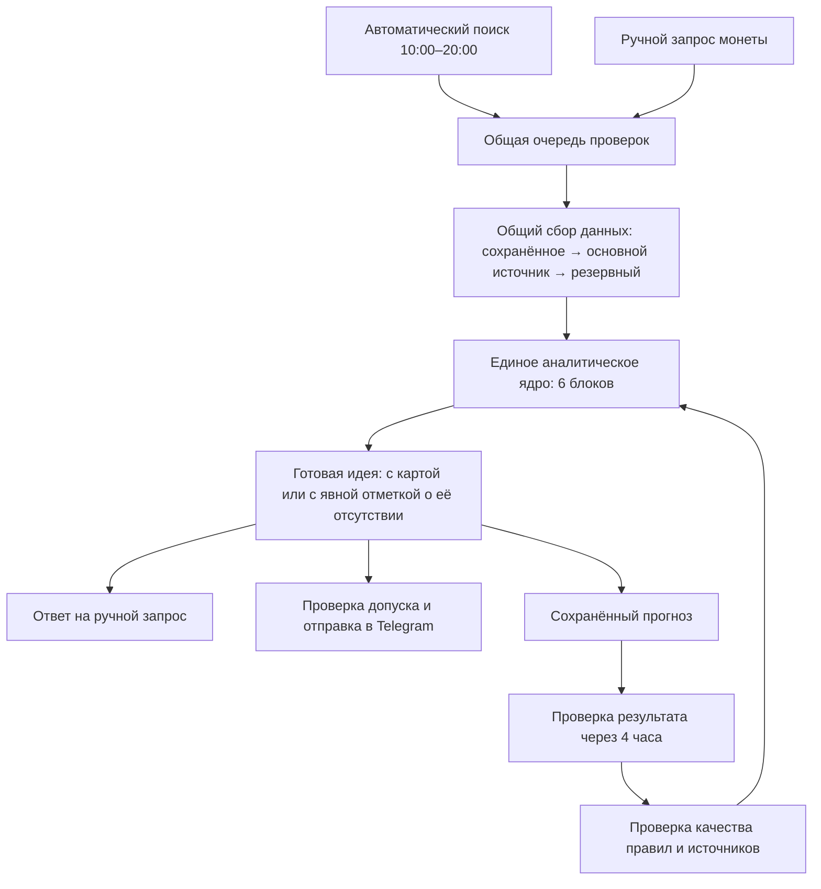

# Памп-отчёт: актуальное ТЗ для передачи координатору

Версия 2. Дата: 25 октября 2026 года, Москва.

## Статус и последнее согласование

Владелец прямо утвердил новую логику ликвидаций: «хорошо давай так и сделаем как ты предлагаешь с ликвидациями».

**Действующее решение:** пригодная карта дополняет готовую идею. Её отсутствие, неполнота, задержка или недоступность в пределах бюджета не блокируют отправку, если остальные обязательные данные и самостоятельный план входа/выхода пригодны. Отсутствие или неполнота обозначаются явно. Ценовые уровни и заявки не называются ликвидациями; недостающие зоны и объёмы не придумываются.

Старое обязательное условие карты заменено во всём документе, включая приёмку. Не применять предыдущую редакцию как действующую. Предложение по ликвидациям больше не ожидает подтверждения.

Численные стартовые настройки, отмеченные как предлагаемые, остаются инженерными гипотезами для проверки; утверждение изменения по ликвидациям не превращает их в доказанные оптимальные значения.

**Передача:** полное ТЗ — в один основной чат, координатору. Он распределяет два крупных пакета между существующими вспомогательными чатами. Все используют эту же версию документа; общую реализацию ведут под координацией, без дублирования задач.

Утверждена конструкция отчёта, а не запуск кода или старой системы. Эта передача сама по себе не разрешает внедрение, рыночный сбор, SQL, Telegram, торговлю, восстановление расписаний, создание новых чатов/агентов/автоматизаций или рассылку заданий в другие чаты. Для выполнения и прямой координации сообщениями нужны соответствующие команды владельца. Сохранённые паузы, бюджеты и правила проекта остаются в силе.

---

## Полное ТЗ

Ниже — итоговое ТЗ для трёх чатов. **Для первого запуска — 6 аналитических блоков. Седьмой, «Устойчивость поддержки», добавляется после запуска, только если проверка подтвердит его пользу.**

Стратегические решения отражают наши согласования. Численные настройки, которые ещё предстоит проверить на данных, отдельно обозначены как **предлагаемые стартовые настройки**. Они не выдаются за доказанно прибыльные правила.

**1. Что должен делать новый «Памп-отчёт»**

Находить растущие криптовалютные фьючерсы BingX, оценивать возможность продолжения движения и показывать понятный план покупки на откате.

Отчёт должен помогать ответить на пять вопросов:

1. Рост ещё развивается или уже выдыхается?
2. Где можно рассматривать покупку после отката?
3. Какие зоны потенциальных ликвидаций находятся сверху и снизу?
4. Где есть обоснованная возможность зафиксировать прибыль?
5. Что изменилось бы настолько, что первоначальный план покупки нужно пересмотреть?

Основной горизонт — **до четырёх часов**. Покупка на вертикальном росте не предлагается. Автоматического выставления ордеров и управления позицией в этом проекте нет.

**2. Согласованные правила**

| Вопрос | Решение |
|---|---|
| Основной рынок | Проверенные криптовалютные бессрочные фьючерсы BingX с расчётом в USDT |
| Направление | Покупка с последующей продажей для фиксации прибыли |
| Отбор растущих монет | **От +20% за последние 24 часа либо от +10% за последние 5, 15 или 60 минут** |
| Верхний предел роста | Отсутствует. Рост на 100–300% сам по себе не исключает монету |
| Одного роста достаточно? | Нет. Обязательны текущая активность, объём, ликвидность и обоснованный план покупки на откате; пригодная карта ликвидаций дополняет анализ |
| Вход | На откате; допускается несколько заявок |
| Глубокий откат | Сам по себе не является причиной исключения |
| Желаемое движение | От 10%, желательно 20% и больше, если для этого есть основания |
| Размер позиции | Обычно 700–2000 долларов, иногда до 3000 |
| Выход | Основной вариант — закрытие всей позиции в выбранной зоне |
| Карта ликвидаций | Дополнительное обоснование. Отсутствие карты не блокирует готовый сигнал, если вход и выход обоснованы остальными обязательными данными; отсутствие или неполнота обозначаются |
| Количество зон | До трёх пригодных зон сверху и до трёх снизу, если они получены. Допустима неполная или отсутствующая карта; недостающие зоны и объёмы не придумываются |
| Автоматическая работа | Ежедневно с **10:00 до 20:00 по Москве** |
| В другое время | Только запуск по ручному запросу |
| Ручные запросы | Обычно около трёх, резерв ресурсов — на шесть полноценных проверок в день |
| Проверка вручную и автоматически | Одно аналитическое ядро, одинаковая полнота проверки |
| Частота сообщений | По появлению качественных идей; искусственной нормы сообщений нет |
| Повторные сообщения | Только при существенном изменении ситуации |
| Обучение | На последующем движении цены и полезности источников, с проверкой изменений перед применением |

Падение всего рынка не запрещает сигнал. Монета, растущая против рынка, может представлять интерес, если остальные данные это подтверждают.

**3. Какие шесть блоков участвуют в запуске**

| № | Блок | Задача | Значение для отправки |
|---|---|---|---|
| **1** | **Цена, объём и стадия движения** | Обнаружить активный рост, определить первую волну, откат, возобновление или ослабление движения | Обязательный |
| **2** | **Реальные покупки и продажи** | Проверить, как исполненные сделки влияют на цену: выкупают ли продажи, поддерживают ли покупки рост | Дополнительный; отсутствие данных не останавливает весь отчёт |
| **3** | **Ликвидность и возможность исполнения** | Проверить разницу между покупкой и продажей, глубину заявок и пригодность монеты для нужного размера позиции | Обязательный |
| **4** | **Состояние фьючерсного рынка** | Использовать открытый интерес и финансирование как дополнительный контекст | Дополнительный |
| **5** | **Сила монеты относительно рынка** | Отличить самостоятельное движение от общего подъёма рынка, проверить полезные сведения с других площадок | Дополнительный |
| **6** | **Карта потенциальных ликвидаций** | Получить доступные пригодные зоны, объединить близкие, оценить их величину и происхождение | Дополнительный; отсутствие, неполнота, задержка или исчерпание бюджета карты не блокируют готовую основную идею |

**Седьмой блок — «Устойчивость поддержки».** Он проверяет, сохраняются ли крупные заявки при приближении цены, происходят ли реальные покупки и восстанавливается ли объём после исполнения.

Этот блок:

- не заменяет карту ликвидаций;
- не делается по одному снимку стакана;
- не становится обязательным условием отправки;
- включается только после проверки дополнительной пользы и расходов.

Таким образом, **шесть блоков не означают шесть отдельных сервисов или шесть обязательных запретов**. Несколько блоков используют одни и те же уже полученные данные.

Управление источниками, хранение, статистика и Telegram — общая обслуживающая часть системы.

**4. Как всё взаимодействует**

Принцип взаимодействия: **каждый факт получается один раз, сохраняется с происхождением и используется всеми нужными блоками**.

Например, свечи одной монеты одновременно нужны для определения роста, анализа отката и проверки результата старого сигнала. Три отдельных запроса за одинаковыми свечами недопустимы.

Ни один аналитический блок не должен самостоятельно обходить бюджет и обращаться ко всем доступным поставщикам. Запросы проходят через общий управляющий компонент.

**5. Единые данные: что обязаны согласовать чаты до разработки**

Координатор первым фиксирует общий формат данных. Без этого два вспомогательных чата не начинают создавать независимые несовместимые реализации.

У каждого полученного факта должны быть:

- точный инструмент и биржа;
- идентификатор актива, а не только название тикера;
- тип рынка и валюта расчёта;
- значение и единицы измерения;
- время, к которому относятся данные;
- время получения;
- срок пригодности;
- источник и, если известно, его первичный поставщик;
- полнота охвата;
- статус: пригодно, неполно, отсутствует, устарело или ошибочно;
- происхождение: наблюдаемый факт либо расчётная оценка.

**Отсутствующее значение не заменяется нулём.**

Особенно важно различать:

- количество монет и денежный объём;
- USDT, USDC и доллары;
- последнюю цену сделки, расчётную цену и индекс;
- открытый интерес в контрактах, монетах или деньгах;
- реальные открытые позиции, расчётную карту и уже произошедшие ликвидации;
- данные BingX и данные другой биржи.

Для результата анализа сохраняются:

- идентификатор монеты;
- идентификатор текущей волны;
- время анализа и опорная цена;
- использованные факты;
- версия правил;
- состояние движения;
- зоны входа, выхода и пересмотра плана;
- доступные пригодные зоны ликвидаций, если они получены;
- режим карточки: с пригодными ликвидационными данными либо без них; полнота карты и точная причина отсутствия/неиспользования;
- основания плана входа и выхода, с отделением ценовых уровней от ликвидаций;
- основания отправки или отказа;
- текст карточки и его контрольная сумма.

Это позволит восстановить, **почему конкретная монета попала в отчёт именно в тот момент**.

**6. Поиск монет: как разрешить ранние сигналы и не пропускать случайный рост**

**Первый этап — широкий недорогой обзор.**

Пакетно получать доступные цены и общую рыночную информацию по всему проверенному списку инструментов. Сохранять компактную историю изменений.

На этом этапе не запрашивать отдельно по каждой монете стакан, сделки, открытый интерес и ликвидации.

**Второй этап — предварительная очередь.**

В неё попадают:

- монеты, приблизившиеся к условиям роста;
- монеты, уже удовлетворяющие им;
- монеты, которые находятся под наблюдением после обнаруженной волны;
- ручные запросы.

Предварительная очередь может быть шире окончательного отбора. Это внутренний список для проверки, а не список сигналов.

**Третий этап — подтверждение роста.**

Для автоматического допуска должно выполняться хотя бы одно условие:

\[
R_{24ч}\geq20\%
\]

или

\[
R_{5м}\geq10\%,\quad R_{15м}\geq10\%,\quad R_{60м}\geq10\%.
\]

Доходность считается между началом и концом соответствующего скользящего периода:

\[
R_w=100\left(\frac{P_t}{P_{t-w}}-1\right).
\]

Запрещено подбирать удобный минимум задним числом и называть рост от него «ростом за пять минут».

Если широкие снимки цен не позволяют точно проверить нужный период, они служат только поводом получить свечи. Окончательное условие подтверждается по подходящим данным.

**Четвёртый этап — проверка текущей волны.**

Монета с +40% за сутки, которая несколько часов стоит без активности, не становится готовой идеей только из-за суточного процента.

Нужно установить, что:

- наблюдалась свежая активная волна;
- движение сопровождалось торговлей;
- сейчас развивается эта волна либо её пригодный откат;
- есть понятный сценарий покупки после отката.

**Важное правило сохранения наблюдения.**

Если монета уже прошла отбор, а затем откатилась, падение её суточного или минутного процента ниже порога **не удаляет её автоматически**.

Именно на таком откате может появиться нужный вход. Монета остаётся в наблюдении до завершения или отмены текущего сценария, но ожидание не продлевается бесконечно каждым новым обновлением.

**Новые монеты.**

Отсутствие полной суточной истории не запрещает участие. Можно использовать доступный подтверждённый период 5, 15 или 60 минут. Недостаток истории для анализа объёма отмечается отдельно; несуществующие сутки не достраиваются.

**Ограничение, которое нужно признать заранее:** при опросе раз в несколько минут невозможно гарантировать обнаружение любого движения, целиком произошедшего между опросами. Увеличение частоты допускается после расчёта ресурсов.

**7. Как анализировать рост и откат**

У блока движения должно быть небольшое число понятных состояний:

| Состояние | Что означает |
|---|---|
| Активная волна | Цена ускоряется, торговая активность подтверждает движение |
| Спокойный откат | Цена отступает после роста, давление продаж относительно ослабевает |
| Резкий откат, возврат не подтверждён | Падение сильное, подходящая зона есть, но выкуп ещё не доказан |
| Резкий откат с возвратом | Цена вернулась за ранее определённый уровень, появились признаки выкупа |
| Возобновление роста | После отката снова усиливаются покупки и движение вверх |
| Ослабление | Большие усилия дают всё меньший рост, повторяются неудачные обновления вершины |
| Сценарий отменён | Исходные основания для покупки больше не выполняются |

Для спокойного отката полезна последовательность:

**активная торговля на росте → уменьшение активности на откате → усиление при возобновлении движения.**

Это дополнительное подтверждение. Оно не становится обязательным для резких проливов.

Для резкого отката проверяются отдельно:

- скорость падения;
- положение относительно заранее известных уровней;
- исполненные продажи, если доступны;
- способность цены продолжать падение под этими продажами;
- скорость и величина возврата;
- возвращение выше пробитого уровня.

**Запрещённая формулировка:** «крупный игрок специально выбил стопы», если для этого нет прямых доказательств.

Допустимая формулировка: «После резкого снижения цену быстро вернули выше уровня; продажи пока не смогли продолжить падение».

Если сведения о направлении сделок неполные, нельзя заявлять, что продавцов точно поглощают. Можно описывать только наблюдаемую реакцию цены.

Рост открытого интереса сам по себе не доказывает набор шортов. Отрицательное финансирование может дополнять картину, но не становится обязательным условием.

Такие признаки близки к известным подходам анализа откатов и поглощения продаж, однако их полезность для наших монет должна проверяться отдельно. Описание подходов: [откаты и изменение объёма](https://www.warriortrading.com/pull-back-trading-strategy/), [поглощение и истощение движения](https://bookmap.com/en/learning-center/supply-demand-setups/supply-demand-setups/absorption-exhaustion).

**8. Предлагаемый стартовый профиль анализа**

Следующие значения — **предложение для первого проверяемого профиля**, а не уже доказанные оптимальные пороги.

| Настройка | Предложение |
|---|---|
| Базовые свечи для активной монеты | 1 минута |
| Обычная история для сравнения | Не менее 60 минут до текущего короткого окна |
| Короткие окна | 3 и 5 минут для активности; 5, 15 и 60 минут для согласованного отбора |
| Признак повышенного объёма | Объём короткого окна примерно вдвое выше медианы предыдущих сопоставимых окон |
| Короткая история новой монеты | Отдельный режим; не смешивать его оценку с полной историей |
| Свежесть цены перед отправкой | До 30 секунд |
| Свежесть стакана | До 15 секунд |
| Допустимое запаздывание закрытых минутных свечей | До 90 секунд |
| Открытый интерес | До 2 минут, если используется |
| Финансирование | До 5 минут с учётом реального периода начисления |
| Карта наблюдаемых открытых позиций | Стартовый ориентир — до 2 минут |
| Внешняя расчётная карта | Стартовый ориентир — до 5 минут; обязательно учитывать время построения у поставщика |
| Запас ресурсов | Плановая загрузка до 80% доступного бюджета после обязательных резервов |

Эти значения проверяются на реальной частоте обновления источников. Если источник обновляет карту реже, нельзя присваивать старой карте новое время при повторном скачивании.

Дополнительные правила расчёта:

- сравнивать объём текущего окна с предыдущими окнами, исключив само текущее;
- при нулевой или неизвестной базе возвращать «сравнение недоступно», а не бесконечный рост объёма;
- базу сравнения начавшейся волны сохранять, чтобы сам памп не уничтожил собственную аномальность;
- повышенный объём проверять на импульсе; не требовать его непрерывно во время спокойного отката;
- разницу двух суточных объёмов не выдавать за точный объём последних минут;
- не считать `цена закрытия × количество монет` точным денежным оборотом всех сделок.

Глубина отката оценивается относительно обычного движения конкретной монеты, разницы цен покупки и продажи и структуры волны. **Единого запрета на откат 10% или 20% нет.**

Все настройки хранятся в одном версионируемом профиле. Чаты не создают разные скрытые пороги в своих блоках.

**9. Ликвидность, вход и выход**

Проверять возможность исполнения для размеров:

**700, 1000, 1500, 2000 и 3000 долларов.**

Для каждого размера рассчитывать доступную глубину с обеих сторон и ожидаемое изменение средней цены при исполнении по текущему стакану.

Предлагаемый начальный ориентир для проверки: разница между лучшей покупкой и продажей до 0,5%, расчётное проскальзывание до 1% на сторону. Эти значения требуют проверки на выбранных монетах.

Если монета пригодна для 700 долларов, но недостаточно ликвидна для 2000, это должно приводить к **понятному ограничению размера**, а не обязательно к исключению всей монеты.

Текущий стакан не гарантирует исполнение будущего ордера. В отчёте нельзя обещать точную цену исполнения заранее.

**Построение входа:**

1. Найти фактически существующие области интереса ниже текущей цены.
2. Сопоставить их со структурой отката; при наличии пригодных зон ликвидаций использовать их как дополнительное основание. Без карты план должен самостоятельно обосновываться движением цены, объёмом и текущей ликвидностью.
3. Выбрать до трёх осмысленных областей покупки.
4. Исключить области, достижение которых уже разрушает первоначальный сценарий.
5. Обозначить, подтверждён ли выкуп или пока предлагается только предварительная область для заявки.

Схема 400 + 300 + 300 остаётся примером пользователя. Не превращать её в обязательное распределение денег.

**Построение выхода:**

- выбрать одну основную обоснованную область фиксации всей позиции;
- остальные верхние зоны показывать как контекст дальнейшего движения;
- не навязывать частичное закрытие;
- учитывать препятствия между входом и желаемой целью;
- не рисовать цель +20% только потому, что пользователь предпочитает такой результат.

Желаемый потенциал считается от предполагаемой цены входа. Он **отличается от вероятности роста на +10% от цены отчёта**, описанной ниже.

**Пересмотр плана:**

Для каждой готовой идеи заранее определить наблюдаемое условие, при котором покупки по первоначальному плану теряют основание.

Если оно наступило, допустимо короткое обновление:

> «Выкуп не удержался. Если ниже остались заявки на покупку, первоначальный план стоит пересмотреть».

Система не утверждает, что пользователь действительно вошёл в позицию или оставил заявки.

**10. Карта ликвидаций: дополнительное обоснование и требования к достоверности**

**Согласовано владельцем 25 октября 2026 года: карта ликвидаций не является обязательным условием каждой автоматической отправки.** Блок остаётся в составе отчёта и используется, когда данные пригодны. Отсутствие карты не понижает требования к движению, объёму, свежести основных данных, ликвидности и обоснованности плана входа/выхода.

Два вида готовых карточек:

1. **С пригодными ликвидационными данными:** показать фактически полученные зоны, их происхождение, величину и ограничения; при неполной карте обозначить пробелы.
2. **Без карты:** отправить готовую основную идею с явной отметкой об отсутствии карты. Показать только те области входа и выхода, которые обоснованы остальными данными. Не называть их ликвидациями или доказанными скоплениями стопов.

Если без карты сам торговый план не обоснован, отправки нет. Одного роста цены недостаточно.

Бесплатное покрытие будущих ликвидаций по всему списку BingX пока не доказано. Источниковый чат проверяет пригодность и расходы в начале своей работы; отсутствие покрытия не задерживает запуск основной готовой цепочки. Не объявлять недоказанный источник работающим.

**Экономная цепочка получения карты:**

- Запрашивать её только для кандидатов, прошедших основную проверку и близких к отправке.
- Сначала использовать уже сохранённые пригодные данные или результат общего выполняющегося запроса. Возраст считать от времени исходных данных.
- При необходимости использовать основной маршрут и ограниченный резерв, в пределах общего и специального бюджетов.
- Ограничивать число запросов и суммарное время ожидания всей цепочки. Предлагаемый стартовый предел ожидания — 10 секунд на готовую карточку, включая резервный маршрут; это проверяемая техническая настройка, а не доказанное оптимальное значение.
- По истечении срока зафиксировать причину и использовать режим без карты, если основной план пригоден. Не продолжать бесконечные повторы и не обнулять уже понесённые/неопределённые расходы.
- Если лимит карт исчерпан, новые обращения за картами прекращаются. Основной анализ и доставка продолжаются только в пределах собственных доступных ресурсов и общих ограничений. Защищённый резерв карты не перераспределяется самовольно.
- Недостаток общих ресурсов, обязательных рыночных данных или пригодного плана по-прежнему способен остановить отправку; новая логика устраняет только обязательную зависимость от карты.
- Позднее получение карты само по себе не вызывает нового сообщения. Обновление допускается только при существенном изменении полезного плана и повторной проверке текущей ситуации.

В журнале различать: пригодна; неполна; отсутствует у источника; устарела; ошибочна; не проверена из-за бюджета; не получена в установленное время. Непроверенную монету не объявлять неподдерживаемой.

Допустимы два типа основания:

1. **Наблюдаемые открытые позиции**, для которых источник публикует текущие расчётные цены ликвидации.
2. **Внешняя расчётная карта**, если понятны её назначение, охват, время построения и шкала величины.

Не допускается заменять будущую карту:

- историей уже состоявшихся ликвидаций;
- обычными заявками в стакане;
- произвольными линиями вокруг цены;
- самостоятельно придуманным распределением плеч;
- картой другого актива с похожим тикером.

**Пригодность определяется для каждой зоны отдельно.** Можно показывать только верхние или только нижние пригодные зоны, прямо обозначая неполноту. Минимальное число зон с каждой стороны не является условием отправки основного отчёта.

При полном отсутствии пригодных зон используется режим без карты. Право показать конкретную зону зависит от её достоверности и сопоставимости с активом, а право отправить основную идею — от пригодности остальных обязательных данных и плана.

Для каждой зоны сохранять:

- нижнюю и верхнюю границы;
- расстояние от текущей цены;
- сторону относительно цены;
- величину либо относительную силу;
- источник и рынок;
- время данных;
- тип основания;
- охват;
- ограничения использования.

**Величина зоны.**

Если источник действительно даёт сопоставимый денежный объём, можно сохранить прежние подписи:

| Объём | Подпись |
|---|---|
| От 10 тысяч до 100 тысяч | Средний |
| От 100 тысяч до 1 миллиона | Большой |
| От 1 миллиона | Огромный |

Это правила отображения, а не доказательство вероятности движения.

Если источник даёт только относительную интенсивность:

- денежный объём не придумывать;
- использовать только проверяемую шкалу этого источника;
- писать, что величина относительная;
- не сравнивать напрямую такую величину с суммой открытых позиций другого источника.

**Объединение зон.**

Близкие совместимые зоны объединять. При этом:

- одна позиция не учитывается дважды;
- вложенные агрегаты не складываются повторно;
- оценки разных моделей не суммируются как независимые деньги;
- цепочка соседних мелких областей не должна незаметно объединять весь широкий диапазон;
- близость определяется с учётом волатильности и шага цены.

Для первых испытаний предлагается объединять пересекающиеся зоны либо зоны с небольшим промежутком, сопоставимым с обычным пятиминутным колебанием. Максимальную ширину объединения ограничить в настройках; не наследовать автоматически старое правило «всё в пределах 5%».

**Выбор до трёх зон с каждой стороны:**

- ближайшая значимая;
- наиболее сильная из оставшихся;
- более удалённая значимая из оставшихся.

Если эти роли выполняют две зоны, показываются две. Если пригодна одна — одна.

Дальняя зона не становится ближайшей целью только из-за большого объёма.

**Данные другой биржи.**

Ликвидации другой площадки могут быть полезны, но:

- должны относиться к тому же активу;
- сохраняют название исходного рынка;
- требуют проверки сопоставимости цены и валюты;
- не называются ликвидациями BingX.

Если перенос цены между площадками ненадёжен, такую карту нельзя использовать для точных заявок на BingX.

**11. Источники и порядок их подключения**

| Источник | Предлагаемое применение | Условие использования |
|---|---|---|
| **BingX** | Инструменты, цены, свечи, стакан, сделки, открытый интерес, финансирование | Основной источник фактов о торгуемом инструменте |
| **SwoleCharts** | Внешние расчётные зоны ликвидаций | Проверить доступ, поддерживаемые монеты, время и шкалу модели |
| **Orderly** | Публичные сведения об открытых позициях | Проверить охват, страницы ответа, единицы и сопоставимость с активом BingX |
| **Hyperliquid** | Данные доступных открытых позиций | Не выдавать наблюдаемые аккаунты за полное покрытие рынка |
| **Bybit, Bitget и другие квалифицированные биржи** | Дополнительный рыночный контекст | Использовать по необходимости, сохраняя биржу и тип инструмента |
| **CoinGecko Demo** | Помощь в проверке идентичности актива | Сохраняемый справочник; не обязательный запрос при каждом сигнале |
| **Существующие дополнительные подключения** | Только факты, которых не хватает и которые реально улучшают анализ | Бесплатность, доступность из рабочего приложения и полезность должны быть подтверждены |

У BingX документированы публичные методы для перечисленных рыночных данных. Но наличие метода в документации ещё не подтверждает корректную работу нашего подключения и пригодность каждого поля: это входит в первую проверку. [Официальная документация BingX](https://github.com/BingX-API/api-ai-skills/blob/main/skills/swap-market/api-reference.md).

У SwoleCharts описаны публичные интерфейсы и модельная природа карты. Её интенсивность нельзя автоматически превращать в точную денежную сумму. [Интерфейсы](https://swolecharts.com/developers), [методика карты](https://swolecharts.com/methodology/liquidation-heatmap).

Orderly и Hyperliquid требуют отдельной проверки границ охвата: доступные позиции не означают знание всех позиций всех площадок. [Orderly](https://github.com/OrderlyNetwork/documentation-public/blob/main/build-on-omnichain/public-info-api/overview.mdx), [Hyperliquid](https://hyperliquid.gitbook.io/hyperliquid-docs/for-developers/api/info-endpoint/perpetuals).

**Не включать в обязательную цепочку** платные карты, пробные тарифы с неизвестным сроком действия и подключения, которые доступны только интерактивно в чате, но не из рабочего приложения.

Наличие установленного подключения не доказывает, что оно подходит для бесплатной автоматической работы.

**Порядок получения каждого факта:**

1. Проверить уже сохранённые пригодные данные.
2. Присоединиться к уже выполняющемуся одинаковому запросу, если он есть.
3. Обратиться к основному источнику.
4. Проверить ответ по смыслу, единицам и времени.
5. При непригодности — использовать подходящий резервный источник в пределах бюджета.
6. При отсутствии результата — сохранить честную причину.

Все источники одновременно не запускаются.

Резервный источник должен заменять **тот же смысл данных**. История ликвидаций не может быть резервом для карты будущих зон.

**Поведение при ошибках:**

- ограничение частоты — соблюдать указанное время ожидания;
- неподдерживаемая монета — временно запомнить отсутствие поддержки;
- повторяющиеся временные ошибки — увеличивать интервал повторов;
- ошибка идентификации или единиц — отключить соответствующее использование до исправления;
- один сбой не делает источник навсегда бесполезным.

Порядок источников задаётся отдельно для каждого вида данных и, где нужно, для каждой монеты.

**12. Как измерять покрытие**

Сохранять отдельные количества:

1. Всего проверенных подходящих инструментов BingX.
2. По скольким доступны базовые рыночные данные.
3. По скольким реально проверена карта ликвидаций.
4. По скольким карта пригодна.
5. По скольким карта непригодна или отсутствует.
6. По скольким проверка ещё не выполнялась.

Нельзя объединять «не проверено» и «данных нет».

Старое покрытие HTX не переносится на BingX. Число инструментов, полученное из общего каталога BingX, также не равно числу подходящих криптовалютных контрактов: сначала нужны классификация и проверка.

**Первый практический результат источникового чата:** таблица покрытия с причинами пробелов и фактической стоимостью получения данных. Отдельно считать число готовых карточек без карты из-за отсутствия покрытия, задержки или бюджета; это не число некачественных монет и не автоматический отказ.

Если покрытия мало, он последовательно проверяет альтернативные бесплатные источники и пригодность уже имеющихся подключений. Несколько оболочек одного поставщика не считаются несколькими независимыми источниками.

**13. Частота работы, очередь и бюджеты**

Базовая схема экономии:

- широкий обзор — пакетный и дешёвый;
- подробная проверка — только кандидатов;
- наиболее свежие данные — перед формированием готовой идеи;
- дополнительная аналитика — только при оставшемся бюджете;
- результат и доставка — с заранее защищённым резервом;
- карта — после основной квалификации кандидата, с отдельным ограничением числа запросов и времени ожидания; её недоступность не блокирует пригодный основной результат.

**Предлагаемые варианты частоты широкого обзора:** 2, 3 или 5 минут. Выбрать самый быстрый, который проходит измерение всех ограничений.

| Интервал | Обзоров за 10 часов |
|---|---:|
| 5 минут | 120 |
| 3 минуты | 200 |
| 2 минуты | 300 |

Для уже выбранных активных монет можно стремиться к проверке раз в 1–2 минуты, если это поддерживают существующий исполнитель и бюджет.

Обещать такую частоту до проверки нельзя. Например, GitHub Actions не обеспечивает расписание чаще пяти минут и допускает задержки запусков. [Ограничения расписаний GitHub Actions](https://docs.github.com/en/actions/reference/workflows-and-actions/events-that-trigger-workflows#schedule).

**Сохранённые ограничения проекта, которые нельзя самовольно увеличивать:**

| Ресурс | Сохранённое ограничение или резерв |
|---|---|
| D1 | 3,5 млн прочитанных и 70 тыс. записанных строк за сутки UTC |
| HTTP на запуск | Общая граница 164 |
| Распределение в сохранённом исполняемом профиле | 96 основных, 56 фоновых, 12 статистических запросов |
| Полная подробная проверка | Внутренний предел 50 |
| Ручная работа | Защищённый резерв 24 HTTP в соответствующем бюджете |
| Ликвидационная цепочка | 8 запросов на запуск; вложенный native-резерв 4 входит в эти 8. Это сохранённый внутренний предел проекта, а не внешняя бесплатная квота; исчерпание прекращает обращения за картой, но само по себе не отменяет готовый основной сигнал |
| Дополнительный резерв по кандидату | 2 запроса входят в общий резерв, а не прибавляются сверху |
| Следующий полный запуск | Сохранённый резерв 59 тыс. чтений и 920 записей |
| Дополнительный дневной предел `hub_daily` | Значение 900 требует установления фактической области применения |

**24 HTTP — не 24 ручных отчёта и не доказательство достаточности резерва на шесть отчётов.**

Перед запуском измерить худшую допустимую стоимость одной ручной проверки. Затем защитить дневной резерв на шесть таких проверок, включая обращения к резервным источникам.

Общий расчёт:

\[
\text{Автоматическая работа}
+\text{6 ручных проверок}
+\text{проверка результатов}
+\text{доставка}
+\text{служебные операции}
+\text{неопределённые расходы}
\leq\text{доступные лимиты}.
\]

Проверять отдельно:

- запросы за секунду, минуту, сутки и месяц;
- строки чтения и записи;
- объём хранения;
- время работы и процессорное время;
- число внутренних запросов;
- размер ответа;
- уже зарезервированные расходы.

Ночной простой не увеличивает дневной предел запросов в секунду.

**Количество одновременно проверяемых кандидатов не фиксировать равным двум.**

Оно вычисляется по оставшимся ресурсам и стоимости конкретных маршрутов. Если доступны пять полноценных проверок — выполнять пять. Если две — две, сохраняя очередь и причину ограничения.

Очередь должна учитывать:

- близость к пригодному входу;
- свежесть движения;
- подтверждённость данных;
- возраст ожидания, чтобы одна монета не занимала всё внимание постоянно.

Ручной запрос получает приоритет и свой резерв, но проходит то же ядро.

**Проверка экономии на практике.**

Перенос старого полного прохода в новый пятиминутный цикл недопустим без расчёта. Например, 54 тыс. чтений и 840 записей на цикл дадут за 120 циклов около **6,48 млн чтений и 100,8 тыс. записей**, что превышает сохранённые дневные ограничения.

Поэтому широкий обзор должен храниться компактными пакетами, а подробная история — преимущественно для кандидатов.

Фактические ограничения выбранного тарифа Cloudflare также проверяются отдельно. Общий объём аккаунта нельзя считать допустимым размером одной базы. [Workers](https://developers.cloudflare.com/workers/platform/limits/), [D1](https://developers.cloudflare.com/d1/platform/limits/).

**14. Расписание и ручной режим**

С 10:00 до 20:00 по Москве работают автоматический поиск, предусмотренные обновления и отправка.

После 20:00:

- новые автоматические проверки не запускаются;
- новые автоматические сообщения не отправляются;
- не выполняется скрытый ночной сбор ради статистики;
- ручная проверка остаётся доступной.

Утром нельзя отправлять вчерашние карточки из накопившейся очереди. Требуется новый анализ.

Если четырёхчасовой срок оценки сигнала заканчивается после 20:00, результат можно восстановить по историческим данным в следующее рабочее окно. Недоступную историческую карту или стакан задним числом не придумывать.

**Ручной запуск должен понимать простые формулировки:**

- «Запусти памп-отчёт для ORDER».
- «Проверь JCT на памп».
- «Что сейчас по этой монете для памп-отчёта?»

Если тикер однозначен, дополнительные вопросы не нужны. Если одному названию соответствуют разные активы, требуется одно уточнение.

Ручной запрос:

- использует тот же сбор и анализ;
- может проверять монету, которая не проходит автоматический отбор;
- выдаёт доступную картину и причину непрохождения; отсутствие карты само по себе не является причиной отказа, если основной план пригоден;
- не превращает отказ в готовую торговую идею;
- сам по себе не включает длительное наблюдение и дополнительные сообщения.

Разница между режимами — **в поводе запуска и правилах публикации**, а не в полноте сведений.

**15. Статистика успешности и честная оценка**

Согласованное значение процента:

> **Вероятность того, что цена монеты вырастет минимум на 10% от цены в момент отчёта в течение следующих четырёх часов.**

Это не вероятность прибыли пользователя.

Для каждого основного сигнала фиксируются:

- время `t₀`;
- проверенная цена `P₀`;
- цель `1,10 × P₀`;
- окончание наблюдения `t₀ + 4 часа`;
- исходные признаки и версия правил.

**Результат:**

- **цель достигнута** — подтверждена цена не ниже `1,10 × P₀` в установленный период;
- **цель не достигнута** — период покрыт пригодными данными, достижения не было;
- **результат неизвестен** — данных недостаточно для честного вывода.

Изменение правил после сигнала не меняет его исходную цель.

Если цена сначала сильно упала, затем достигла цели, формально событие произошло. Но отдельно записываются:

- максимальное снижение до достижения цели;
- максимальное снижение за весь период;
- время достижения;
- произошло ли достижение после отмены первоначального плана.

Это не позволяет скрывать неприятный путь цены за красивой долей успешных прогнозов.

**Точность проверки.**

Если максимум минутной свечи мог появиться до момента отчёта или после окончания четырёх часов, он не считается доказательством без уточняющих данных.

Если найдено достоверное достижение цели, сам факт достижения может быть известен даже при пробелах в другом участке. Но величина максимального отката при таких пробелах остаётся неизвестной.

**Отдельная статистика входа:**

- дошла ли цена до предложенной области;
- что произошло после её достижения;
- была ли достигнута предполагаемая область выхода;
- насколько глубже ушла цена.

Касание лимитной цены не доказывает исполнение заявки пользователя. Такая статистика называется проверкой сценария, а не реальной прибылью.

**От пользователя не требуется сообщать каждую сделку.** Реальные результаты можно добавить позднее добровольно, отдельным набором данных.

**Защита от красивой, но ложной статистики:**

- повторные обновления одной волны не считаются независимыми победами;
- ручные запросы и автоматические сигналы учитываются раздельно;
- карточки с пригодными ликвидационными данными и без них учитываются раздельно; неполнота карты и причина её отсутствия сохраняются;
- отправленные и неотправленные готовые идеи различаются;
- неизвестные исходы не записываются как проигрыши или победы;
- данные, полученные позднее, не попадают в исходные признаки сигнала;
- проверка новых правил выполняется на более позднем периоде, который не использовался для настройки.

**16. Когда появляется процент и как система учится**

На первом запуске разрешены полезные сигналы **без численного процента**, если статистика ещё не позволяет его честно оценить.

Вместо выдуманных 90–100 указываются конкретные основания:

> «Рост поддержан активностью; откат проходит на меньшем объёме; нижняя расчётная зона сохраняется».

Внутренний порядок проверки монет не отображается как вероятность.

**Вероятность проверяется для режима, в котором выпущена карточка.** Нельзя переносить оценку, полученную только на сигналах с картой, на сигналы без карты. Нельзя произвольно прибавлять или отнимать баллы за наличие/отсутствие карты. До достаточной статистики соответствующего режима численного процента нет; фактическое объяснение остаётся.

Пользу карты проверять на сопоставимых случаях и по сведениям, доступным в момент отчёта. Разница долей успеха двух разных наборов монет сама по себе не доказывает пользу карты. Ради этого сравнения не запускать массовый дополнительный сбор карт и не подставлять карты, появившиеся позднее, в исходный анализ.

**Предлагаемый первый способ оценки — простой и проверяемый:**

1. Разделить случаи на несколько понятных сценариев: спокойный откат, резкий откат без подтверждения возврата, резкий откат с возвратом.
2. Для каждого считать долю достижения согласованной цели.
3. При малом числе примеров использовать более общую группу, а не строить десятки мелких категорий.
4. Проверять, совпадают ли выдаваемые вероятности с последующей частотой событий.
5. Показывать процент только для групп, прошедших проверку.

**Предлагаемый начальный допуск численного процента:**

- не менее 300 различных эпизодов;
- не менее 20 монет;
- не менее 14 календарных дней;
- минимум 100 последних эпизодов выделены для последующей проверки;
- достаточно примеров в используемой группе;
- доверительный диапазон и ошибка соответствия прогнозов фактам укладываются в заранее записанные границы.

Это инженерные условия допуска, **не гарантия качества по самому факту достижения числа 300**.

До достаточной точности округлять оценки, не создавать видимость различия между 94, 95 и 97. Значение 100% не использовать как обещание.

Принцип проверки вероятностей описан в [документации по калибровке](https://scikit-learn.org/stable/modules/calibration.html); последовательное разделение данных по времени — в [документации TimeSeriesSplit](https://scikit-learn.org/stable/modules/generated/sklearn.model_selection.TimeSeriesSplit.html).

**Как статистика влияет на работающую систему:**

- выявляет признаки, которые действительно улучшали результаты;
- показывает сценарии с частыми глубокими откатами;
- помогает корректировать порядок проверки кандидатов;
- выявляет источники, которые дают мало пригодных данных за большую стоимость;
- позволяет предлагать более удачные настройки.

Изменение сначала проверяется параллельно действующим правилам, без влияния на сообщения. После сравнения принимается новая версия с возможностью возврата к предыдущей.

Не должно быть механизма, который после нескольких удачных случаев самостоятельно переписывает всю стратегию.

**Статистика источников разделяется на две части:**

| Часть | Что измеряется |
|---|---|
| Работоспособность | Успешность запросов, задержки, свежесть, покрытие, цена получения, ошибки |
| Аналитическая польза | Улучшает ли использование данных результат на сопоставимых случаях |

Источник не становится «хорошим» только потому, что одна монета после его ответа выросла.

**17. Что хранить**

Хранение должно обеспечивать повторную проверку решения, а не бесконтрольное накопление всего подряд.

| Данные | Что сохранять |
|---|---|
| Каталог инструментов | Идентичность, статус, единицы, изменения |
| Широкий обзор | Компактные пакетные снимки цен и минимальные признаки |
| Активные кандидаты | Нужную короткую историю, состояние волны, свежие факты |
| Карта ликвидаций | Исходное происхождение, нормализованные зоны, время, ограничения |
| Основной сигнал | Неизменяемый снимок признаков, план и его основания, текст, версию правил, наличие/полноту карты и причину её отсутствия |
| Отправка | Намерение отправить, состояние, подтверждение, идентификатор сообщения |
| Результат | Цель, срок, достижение, откаты, полноту данных |
| Источники | Сводные показатели доступности, расходов и полезности |

Для каждого набора фиксируются:

**кто использует → за какой период → сколько хранить → когда можно удалять.**

До измерения фактической ёмкости нельзя назначать большие сроки хранения произвольно. Незавершённые исходы, неопределённые отправки и данные, необходимые для проверки отчёта, защищаются от очистки.

Старую сохранённую историю и подключения ради нового отчёта не удалять.

**18. Короткая карточка для пользователя**

Форма карточки постоянная, но объяснение строится по фактам конкретного случая.

Обязательные элементы:

1. Тикер.
2. Вероятность согласованного события, если она уже обоснована.
3. Одна-две короткие фразы о происходящем.
4. Области покупки.
5. Основная область фиксации прибыли.
6. Доступные пригодные зоны ликвидаций — до трёх сверху и снизу — с достоверной величиной; при отсутствии или неполноте данных вместо выдуманных зон показать короткую честную отметку.
7. Короткое существенное предупреждение, если оно есть.

Схема отображения:

> **ТИКЕР · +10% за 4 часа: [проверенная оценка]**  
> [Что происходит именно сейчас и чем подтверждается.]  
> **Покупка:** [область или несколько областей].  
> **Фиксация:** [основная область].  
> **Ликвидации сверху:** [доступные пригодные зоны либо отметка об отсутствии данных]; […]  
> **Ликвидации снизу:** [доступные пригодные зоны либо отметка об отсутствии данных]; […]  
> **Важно:** [существенное условие пересмотра плана].

Если процент ещё не обоснован, вместо него коротко: **«Вероятность пока не оценена»**.

Если карта расчётная, это должно быть видно. Если относится к другой площадке, происхождение нельзя скрывать.

При отсутствии карты две строки зон заменяются одной:

> **Карта ликвидаций недоступна. Области входа и выхода определены по движению цены.**

Формулировку оснований уточнять по реально использованным данным. Обычные уровни на графике, заявки в стакане и предполагаемые области стопов не переименовывать в ликвидации; денежные объёмы для них не придумывать. Наличие полноценного плана без карты не означает, что сведения о ликвидациях стали известны.

**Как исключить бессодержательные шаблоны:**

Сначала ядро формирует набор подтверждённых выводов. Затем текст выбирает:

- два наиболее важных основания;
- один главный риск;
- текущее действие: ждать область, рассматривать область после подтверждения, пересмотреть старый план.

Для спокойного отката и резкого неподтверждённого пролива объяснения обязаны отличаться по смыслу.

Не писать без доказательств:

- «крупный игрок набирает»;
- «стопы специально выбили»;
- «дальше точно будет вторая волна»;
- «ликвидации обязательно притянут цену»;
- «сильный сигнал», если дальше нет объяснения.

Для первой версии достаточно детерминированного составления текста из фактов. Обязательный внешний языковой сервис не нужен: он не должен стать новой точкой отказа.

**19. Telegram: доставка — часть приёмки, а не последний штрих**

Готовая карточка сначала сохраняется, затем попадает в отдельную очередь отправки.

Обязательные свойства:

- один идентификатор карточки;
- контрольная сумма текста;
- единственный исполнитель отправки;
- сохранённое состояние;
- возможность продолжить после перезапуска;
- отсутствие повторной отправки из-за одновременного ручного и автоматического запуска.

Минимальные состояния:

`готово → взято в отправку → отправлено`

Дополнительные состояния:

`повтор допустим / исход неизвестен / ошибка / устарело`.

**Отправка считается подтверждённой**, когда получен корректный ответ Telegram с идентификатором сообщения, он связан с нужной карточкой и получателем, а подтверждение сохранено и прочитано обратно.

Это подтверждает приём сообщения Telegram, а не его прочтение пользователем.

Если соединение оборвалось после возможной отправки, нельзя автоматически считать сообщение неотправленным и бесконечно повторять. Состояние должно быть «исход неизвестен», с попыткой разобраться по журналу посредника.

Telegram `sendMessage` не предоставляет универсальной гарантии «ровно одна доставка» для нашего повторного запроса при потерянном подтверждении. Это ограничение нельзя скрывать. [Telegram Bot API](https://core.telegram.org/bots/api#sendmessage).

**Перед задержанной отправкой повторно проверить:**

- рабочее время;
- свежесть карточки;
- действительность сценария;
- отсутствие уже отправленной версии;
- отсутствие существенного изменения цены.

Устаревшая карточка отменяется или пересчитывается. Она не отправляется утром следующего дня.

**Защита от спама:**

- одна основная карточка на текущий эпизод;
- повтор — только при изменении, важном для решения;
- небольшое колебание цены или оценки не является поводом;
- разные качественные монеты могут приходить подряд;
- статистические сводки автоматически не присылать.

Проверка статистики не должна блокировать уже подготовленную отправку.

**20. Что переиспользовать из старого проекта**

Переиспользуются отдельные пригодные механизмы. Старые условия готовности целиком не переносятся.

| Область | Что использовать | Что изменить |
|---|---|---|
| BingX | Адаптер рынка и описание инструментов | Подключить к новому общему пути, проверить идентичность и единицы |
| Общие рыночные данные | Пакетные снимки, контракты данных, чтение истории | Короткие окна, нужные текущей стратегии |
| Бюджеты | Общий учёт, резервы, журнал расходов | Новый фактический план нагрузки в существующих пределах |
| Ликвидации | Цепочку источников, разбор и объединение зон | Квалификация для BingX, модельные карты, честный охват и единицы |
| Поток сделок | Пригодные части анализа покупок и продаж | Не требовать обязательных четырёх часов полной истории со всех бирж |
| Контекст рынка | Пригодные расчёты относительной силы | Сделать дополнительными |
| План входа | Проверенные вспомогательные расчёты | Не подменять вход произвольной полосой вокруг цены |
| Статистика | Хранение исходов и версии правил | Новая цель: +10% от цены отчёта за четыре часа |
| Telegram | Очередь, квитанции, связь с сохранённым текстом | Допуск отдельной монеты и честная обработка неопределённой отправки |

**Обязательно убрать из пути нового отчёта старые условия, если они там остаются:**

- готовность всего прежнего списка HTX;
- ровно две монеты;
- прежний порог 70 баллов;
- обязательность всех старых аналитических блоков;
- запрет всех расчётных карт ликвидаций;
- обязательность карты или минимального числа зон для каждой автоматической отправки; отсутствие карты само по себе больше не является блокировкой;
- длинную историю как универсальное условие допуска;
- старую логику коротких позиций;
- общий запрет отправки из-за ошибки по посторонней монете.

Сохранённый механизм продолжения волны не считать готовым новым детектором только из-за названия. Старый расчёт области входа также не считать готовым планом покупки на откате без проверки его реального поведения.

Разблокировки токенов, социальные сообщения, опционы, широкий новостной сбор и другие прежние направления не включаются в обязательную первую версию. Справочные сведения могут использоваться позднее, если измерена польза.

**21. Организация трёх чатов**

Работают **три существующих чата**. Новые чаты, подагенты и автоматизации для организации разработки не требуются.

**Порядок передачи:** владелец передаёт полное актуальное ТЗ одному основному чату — координатору. Два вспомогательных чата работают по его конкретным крупным пакетам; им нужен доступ к той же версии полного ТЗ как к общему справочнику, а не три независимых задания «сделай весь отчёт».

Если у всех чатов есть доступ к этому общему рабочему каталогу, достаточно ссылки/точного пути и версии документа. Если доступа нет, координатор подготавливает два самодостаточных задания, а владелец переносит их и актуальный файл в соответствующие существующие чаты. Прямая отправка сообщений между чатами выполняется только при отдельном явном разрешении владельца; это ТЗ такого разрешения не создаёт.

Каждое задание содержит: версию ТЗ, границы пакета, входы/выходы, владельца файлов, проверки и формат возврата результата координатору. Изменения согласованной стратегии вспомогательные чаты самостоятельно не принимают.

| Роль | Ответственность | Основной результат |
|---|---|---|
| **Координатор** | Общие форматы, распределение файлов, бюджет, исполнитель, расписание, ручной запуск, Telegram, объединение и приёмка | Один работающий путь от обнаружения до подтверждённой отправки |
| **Исполнитель по источникам** | BingX, дополнительные источники, идентификация на стороне адаптеров, свежесть, единицы, резервирование источников, карта ликвидаций, измерение расходов | Пригодные нормализованные данные и честная таблица покрытия |
| **Исполнитель по аналитике** | Движение, откаты, использование потока сделок и контекста, план входа/выхода, текст, исходы и калибровка | Проверяемое единое аналитическое ядро |

**Правила координации:**

- у каждого изменяемого файла один владелец;
- общие форматы сначала фиксирует координатор;
- исполнитель не создаёт собственный учёт расходов и отдельный путь отправки;
- изменения общих форматов проходят через координатора;
- исходные версии и передачи результатов фиксируются;
- сообщения о завершении содержат выполненное, проверки, ограничения и точную версию;
- «готово» без проверяемого результата не принимается.

Координатор отвечает за то, чтобы полезная часть не зависала из-за необязательного улучшения.

**22. Крупные пакеты выполнения**

**Пакет А. Проверка реализуемости и первый полный проход.**

Сначала коротко проверить наиболее рискованные предположения:

- данные BingX доступны из рабочего приложения;
- единицы и время понятны;
- для выбранных примеров установлен честный статус бесплатной карты: пригодна, неполна либо недоступна; пригодный основной отчёт может пройти без неё;
- стоимость маршрута укладывается в лимиты;
- путь Telegram способен сохранить и подтвердить отправку.

Это небольшая ранняя проверка, а не отдельный многонедельный аудит.

Далее параллельно:

- **источники:** рабочие адаптеры BingX и карты, нормализованные ответы, расходы;
- **аналитика:** единый разбор сценария и короткая карточка на сохранённых примерах;
- **координатор:** общие форматы, сохранение, бюджет, очередь и доставка.

Результат пакета — **одна настоящая монета проходит весь путь**, с реальными пригодными обязательными данными и проверяемой отправкой. При отсутствии карты допустим согласованный режим без неё. Техническая проверка доставки явно отделяется от торговой идеи.

Ветка с картой считается подтверждённой только после получения и проверки реальных пригодных зон; её неподтверждённость честно фиксируется и не выдаётся за завершённое покрытие. Поиск полезных бесплатных источников продолжается в ограниченном источниковом пакете, не удерживая готовый основной запуск.

**Пакет Б. Полный рабочий отчёт.**

Параллельно:

- **источники:** широкий каталог, резервные маршруты, отрицательные результаты, покрытие;
- **аналитика:** все согласованные сценарии, отказ при недостаточных обязательных данных, проверка исходов;
- **координатор:** многомонетная очередь, расписание, ручной режим, резервы, защита от повторов.

Результат — автоматическая работа в заданные часы и полноценный ручной запуск, использующие одно ядро.

**Пакет В. Проверка качества и полезные улучшения.**

После рабочего запуска:

- накопить исходы;
- проверить вероятность и признаки;
- проверить полезность источников;
- испытать седьмой блок без влияния на сообщения;
- включать улучшения только после подтверждения пользы.

**Накопление статистики не задерживает запуск первой версии.** Оно задерживает только публикацию необоснованного процента.

**Как проверять крупными блоками:**

- внутри пакета — проверки непосредственно изменённых контрактов и функций;
- при передаче — один согласованный набор проверок пакета;
- после объединения — общий набор проверки нового отчёта;
- повторять весь большой набор только после изменений, которые действительно затрагивают проверенное поведение.

Не запускать старую полную батарею после каждой мелкой правки. При этом не откладывать обнаружение несовместимости форматов до конца всей разработки.

**23. Обязательная приёмка**

Координатор принимает результат только после следующих проверок.

| Проверка | Ожидаемый результат |
|---|---|
| Монета +12% за 15 минут, но меньше +20% за сутки | Может пройти ранний путь |
| Монета +50% за сутки, но движение давно неактивно | Один суточный процент не вызывает отправку |
| Отобранная монета откатилась ниже порога роста | Наблюдение за пригодным сценарием сохраняется |
| Монета выросла больше 100% | Не исключается только из-за величины роста |
| Спокойный и резкий откаты | Получают разные содержательные объяснения |
| Нет открытого интереса | Не блокирует пригодный отчёт целиком |
| Нет данных о направлении сделок | Не появляются утверждения о поглощении продаж |
| Нет карты, но обязательные данные и самостоятельный план входа/выхода пригодны | Готовая карточка отправляется с явной отметкой об отсутствии карты и без выдуманных зон |
| Нет карты и без неё план не обоснован | Отправки нет; причина — непригодность плана, а не сам факт отсутствия карты |
| Есть только верхние либо только нижние пригодные зоны | Показываются доступные зоны и неполнота; отсутствие второй стороны не блокирует пригодную основную идею |
| Источник карты задерживается или её бюджет исчерпан | Цепочка карты ограничивается по времени/расходам; основной готовый результат не ждёт бесконечно и отправляется при наличии общих ресурсов |
| Модель вероятности проверена только для карточек с картой | Процент не переносится автоматически на карточку без карты |
| После отправки получена карта, но полезный план не изменился | Дополнительного сообщения нет |
| Есть две нижние зоны | Третья не выдумывается |
| Несколько источников содержат одинаковые позиции | Объём не удваивается |
| Карта относится к другой бирже | Это сохраняется в данных и понятном отображении |
| Для 700 долларов ликвидность достаточна, для 2000 — нет | Выдаётся ограничение размера |
| Ошибка по одной монете | Другие пригодные монеты продолжают обрабатываться |
| Ручной и автоматический запуск совпали | Общие данные переиспользуются, лишняя отправка не возникает |
| Основной источник исчерпал лимит | Используется пригодный резерв либо фиксируется честный недостаток данных |
| Бюджет почти исчерпан | Защищённые ручные и доставочные резервы сохраняются |
| Несколько качественных монет одновременно | Нет старого ограничения «ровно две» |
| Нет качественных идей | Нет искусственных сигналов |
| Неполный обзор из-за ошибки | Не называется «рынок проверен, идей нет» |
| Наступило 20:00 | Новые автоматические сообщения прекращаются |
| Утренний запуск | Вчерашняя очередь не отправляется без пересчёта |
| Подтверждение Telegram потеряно | Нет ложной записи об успешной отправке и слепого повторения |
| Цель достигнута после сильного падения | Достижение и неблагоприятный путь записаны отдельно |
| История неполна | Неизвестный исход остаётся неизвестным |
| Повторные обновления волны | Не увеличивают искусственно число успешных прогнозов |

**Финальное доказательство работы:**

`реальные обязательные данные → обоснованный план → пригодные зоны карты при наличии либо явная отметка об её отсутствии → сохранённый анализ → тот же текст в Telegram → сохранённое подтверждение → последующая проверка исхода`.

Одних искусственных примеров, успешных локальных проверок или записи «отправлено» без квитанции недостаточно.

**24. Условия начала реализации и границы обещаний**

Старый проект остаётся на паузе. Это ТЗ само по себе не запускает сбор, статистику, Telegram и прежние фоновые задачи.

Перед будущей реализацией координатор проверяет свежий основной код, действующие инструкции и сохранённые ограничения. Сохранённая точка `d4dac37ba1002e8130ad1991d1830eb2e92e8212` — ориентир восстановления, а не доказательство текущего состояния основной ветки.

Два ранее отложенных владельцем направления — сопровождение входа и проверка устойчивой ёмкости хранения — нельзя молча считать разрешёнными целиком. Нужно определить, какие конкретно изменения нового отчёта их затрагивают, и действовать в пределах команды на реализацию. Не требуется ради этого автоматически возобновлять все старые блоки.

Что нельзя обещать до проверки:

- бесплатную полноценную карту для каждой монеты BingX;
- обнаружение каждого пампа в самом начале;
- восстановление неизвестных открытых позиций по обычным свечам;
- определение намерений участников рынка;
- прибыль пользователя по факту роста цены;
- достоверные 95–97% без соответствующей статистики;
- безусловную доставку без дублей при любом сетевом сбое.

**Главный критерий готовности:** отчёт регулярно находит подходящие ситуации, объясняет их по реальным данным, честно показывает ограничения и доставляет полезные карточки. Количество подключений, блоков и проведённых проверок само по себе результатом не считается.
